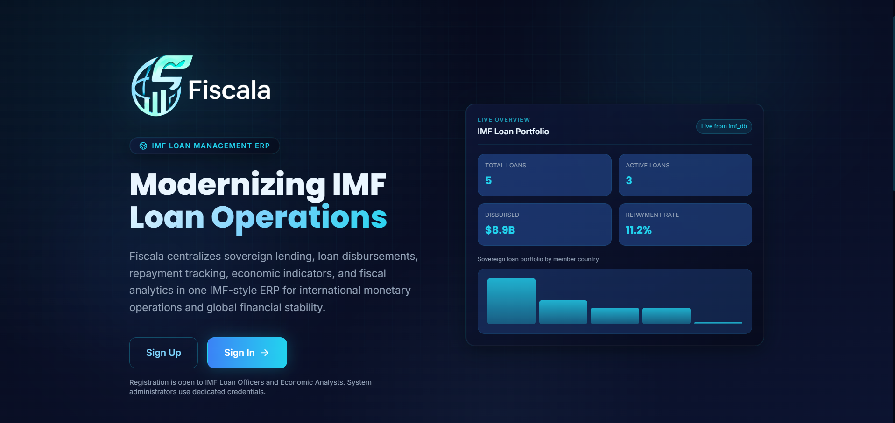
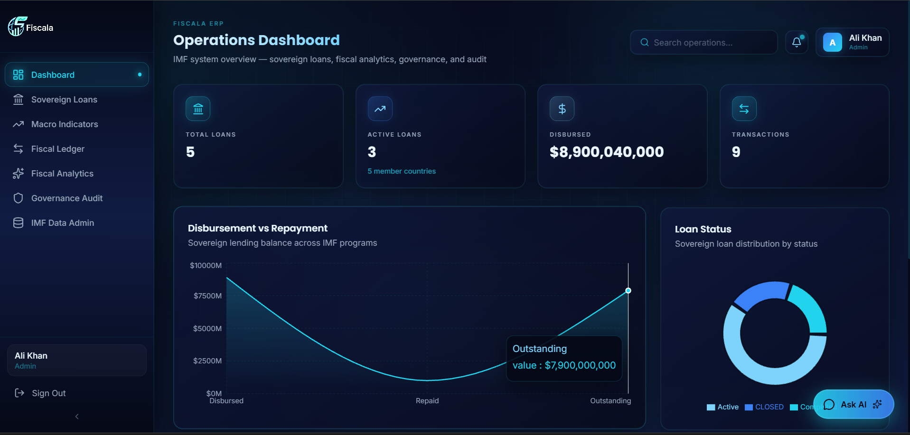
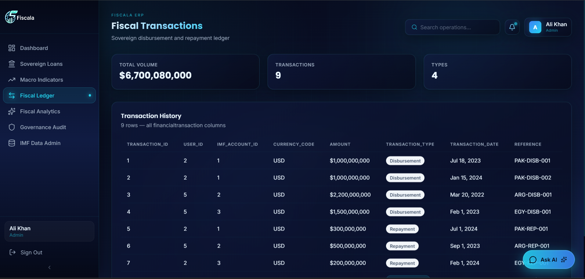
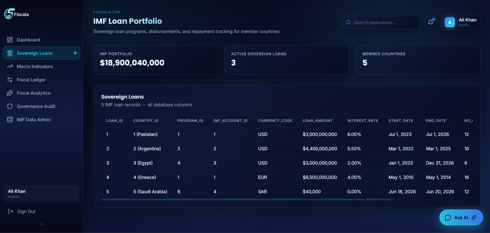
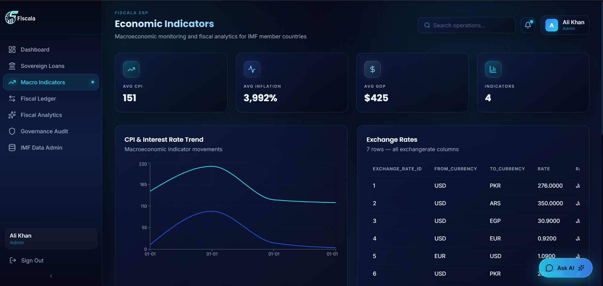

# FISCALA-IMF Loan Management ERP System




A full-stack loan management system built using **Python, FastAPI, SQLAlchemy, PostgreSQL, React, TypeScript, and Relational Database Design** principles. The system models the operations of an IMF-style lending institution — loan programs, disbursements, repayments, multi-currency accounts, and country-level economic data — and adds an AI-assisted natural-language analytics agent on top of the relational core.

## Overview:

The project streamlines sovereign loan administration by letting financial officers process disbursements and repayments (with automatically generated installment schedules), letting economic analysts maintain country-level fiscal indicators (CPI, GDP, inflation, exchange rates), and giving administrators full user, role, and audit-log oversight. Any authenticated user can also ask a plain-English question — e.g. *"top 5 countries by inflation"* — and get back a live chart, table, or a downloadable PDF/CSV, generated through a role-checked query pipeline rather than free-form SQL.

## Features:

### Officer Features:

* Full CRUD on currencies, countries, loan programs, IMF accounts, and loans
* Loan conditions and condition-to-loan mapping
* **Automated disbursement workflow** — sequences the disbursement number, generates the full installment schedule on first disbursement, activates the loan, and posts a linked financial-transaction record in one call
* **Automated repayment workflow** — sequences the repayment number, computes the running outstanding balance, and allocates the payment against the fixed installment schedule
* View financial transaction history and disbursement/repayment links

### Economic Analyst Features:

* Create and manage economic indicators per country and date (CPI, industrial/agricultural/services output, money supply, interest rate, exchange rate)
* Manage derived economic records (GDP, inflation) linked to those indicators
* Manage exchange rates between currency pairs
* Generate structured natural-language PDF reports (intro, data table, charts, conclusion) from a prompt

### Administrator Features:

* Full user management and role assignment (Admin / Officer / Economic Analyst)
* System-wide audit log visibility, filterable by user or log entry
* All Officer and Economic Analyst capabilities
* The only role permitted to create/update/delete data or trigger disbursement/repayment **through the AI assistant's natural-language interface**

### AI Analytics Assistant (all authenticated roles):

* Ask natural-language questions about loan and economic data (e.g. *"average GDP by country in the last 2 years"*, *"show overdue installments"*) and receive a dashboard-ready chart or table
* Multi-turn conversation support — follow-up questions like *"also show GDP"* resolve against the prior exchange
* Export any analytics result as **PDF** (table + chart image) or **CSV**
* Query history is itself logged and viewable (own history for all roles, all users' history for admins)
* Backed by Groq (via LangChain) as the primary planner, with a deterministic rule-based parser as an automatic fallback when no API key or quota is available — the system keeps working either way

## Technology Stack:

| Category | Technologies | Role in this project |
|---|---|---|
| **Backend framework** | Python, **FastAPI** | Exposes the entire REST API (auth, loans, transactions, economic data, analytics, audit logs) with dependency-injected auth and auto-generated Swagger/ReDoc docs |
| **ORM / Database access** | **SQLAlchemy 2.0** | Declarative ORM models for all 21 tables; the AI query pipeline compiles natural-language questions into parameterized SQLAlchemy queries rather than raw SQL |
| **Validation** | **Pydantic** | Request/response schemas (`app/schemas.py`, `app/analytics_schemas/`) validate every API payload, including the internal contracts of the analytics pipeline |
| **Database** | **PostgreSQL** | Primary relational store, configured via `DATABASE_URL`; a local SQLite file (`fiscala_local.db`) is present for local inspection/dev only |
| **Authentication** | **python-jose (JWT / HS256)**, **passlib + bcrypt** | Stateless JWT access/refresh tokens; bcrypt password hashing |
| **AI / LLM layer** | **LangChain (`langchain-core`, `langchain-groq`) + Groq API** | Plans structured, permission-checked query specs from natural-language input (see AI Layer section below); not used for model training |
| **Reporting** | **ReportLab**, **Matplotlib** | Server-side PDF generation (tables + chart images) and chart rendering for exports |
| **Frontend framework** | **React 19 + TypeScript** | Confirmed via `frontend/src/**/*.tsx` and `frontend/tsconfig*.json` — builds every page and component (Dashboard, Loans, Economic, Transactions, Analytics chat UI, Admin panel) |
| **Build tool** | **Vite** | `frontend/vite.config.ts` configures the dev server and dev-time API proxy (`/api` → `http://127.0.0.1:8000`); also drives the production build |
| **Styling** | **Tailwind CSS v4** | Loaded via the official `@tailwindcss/vite` plugin and `@import "tailwindcss"` in `src/index.css`, with a custom design-token theme (colors, fonts) — no Bootstrap or plain CSS framework is used |
| **Routing** | **React Router v7** | Client-side routing plus a custom `RoleRoute` guard that mirrors the backend's RBAC on the frontend |
| **Charts** | **Recharts** | Renders the AI-generated dashboards and static report charts in the browser |
| **UI/animation utilities** | **Framer Motion**, **lucide-react** | Page/element animation and icon set |
| **Runtime tooling** | **Node.js + npm** | Required to run Vite, TypeScript, and the React toolchain (`package.json` / `package-lock.json`); Node.js itself does not run any application backend logic — that is entirely FastAPI/Python |

**A note on the frontend, since it's easy to assume otherwise from a FastAPI project:** this is a genuine React 19 + TypeScript single-page app, not server-rendered templates. It lives entirely in `frontend/`, is built with Vite, styled with Tailwind CSS v4, and talks to the FastAPI backend purely over JSON/REST — there is no Django, no Jinja templates, and no plain HTML/CSS/vanilla-JS frontend anywhere in this project.

## Architecture:

* **Frontend (React + TypeScript + Vite + Tailwind):** renders all pages and components, owns client-side routing/role-gating (`RoleRoute`), and calls the backend exclusively through a typed API client (`frontend/src/lib/api.ts`) using the JWT stored client-side.
* **Backend (FastAPI + Python):** all business logic lives in `app/services/` (e.g. disbursement/repayment automation, analytics planning, report generation); `app/routers/` handles HTTP concerns only; `app/auth/` issues and verifies JWTs and resolves the caller's role.
* **Database (PostgreSQL + SQLAlchemy):** 21 normalized tables (see Database Design below) accessed exclusively through SQLAlchemy ORM models in `app/models.py` — no raw SQL string concatenation from request data anywhere in the codebase.
* **AI layer:** natural-language input goes to `app/services/analytics_llm_service.py`, which calls the Groq API through LangChain to produce a structured `AnalyticsSpec`/`NLQueryPlan` object — never SQL text. That plan is validated field-by-field against the caller's role (`app/core/analytics_permissions.py`, `app/core/allowed_fields.py`) before `query_builder_service.py` turns it into a safe SQLAlchemy query. If Groq is unavailable or its quota is exhausted, `nl_rule_fallback.py` produces the same structured object using deterministic keyword/pattern matching, so the feature degrades gracefully instead of failing. Results are shaped into chart-ready JSON by `visualization_service.py` and rendered by Recharts on the frontend, or turned into a PDF/CSV file by `dashboard_export_service.py` / `report_generation_service.py`.

## Screenshots:


 ### Dashboard
 

 ### Fiscala Intelligence-AI  Assistant
 .png)
 .jpeg)

 ### Fiscala Ledger
 
 ### Sovereign Loans
 
 ### Economic Indicators
 
 
## Installation & Setup:

### Backend

**1. Clone the repository**

```bash
git clone <repository-url>
cd DBMS_CEP_102_103_104_109
```

**2. Create the PostgreSQL database**

```sql
CREATE DATABASE imf_db;
```

**3. Configure environment variables**

Create an `app/.env` file using `app/.env.example` as a template:

```env
DATABASE_URL=your_database_url
JWT_SECRET_KEY=your_jwt_secret
GROQ_API_KEY=your_groq_api_key


**4. Create a virtual environment**

```bash
python -m venv venv
```

Activate it:

**Windows**

```bash
venv\Scripts\activate
```

**macOS / Linux**

```bash
source venv/bin/activate
```

**5. Install dependencies**

```bash
pip install -r requirements.txt
```

**6. Run the backend server**

```bash
uvicorn app.main:app --reload
```

Tables are created automatically on first startup. API runs at `http://127.0.0.1:8000`; interactive docs at `http://127.0.0.1:8000/docs`.

### Frontend

```bash
cd frontend
npm install
npm run dev
```

The Vite dev server runs on port `5173` by default and proxies `/api` requests to the backend at `http://127.0.0.1:8000` (see `frontend/vite.config.ts` and `frontend/.env.example`).

### First admin user

Admins cannot self-register through the API. Create the first one directly in PostgreSQL:

```bash
python -c "from passlib.context import CryptContext; ctx = CryptContext(schemes=['bcrypt']); print(ctx.hash('your_password_here'))"
```

```sql
INSERT INTO users (name, email, password) VALUES ('Admin User', 'admin@imf.org', '<bcrypt_hash>');
INSERT INTO admin (user_id, admin_type, access_scope) VALUES (1, 'super', 'full');
```

Officer and analyst accounts can then be created by an admin via `POST /users/officer/` and `POST /users/analyst/`.


## Roles & Permissions:

| Role | Access |
|------|--------|
| **Admin** | Full access to everything, including user management, system-wide audit logs, and AI-driven create/update/delete/disbursement/repayment actions |
| **Officer** | Loan processing, disbursements, repayments, financial transaction records |
| **Economic Analyst** | Economic indicators, records, exchange rates, structured report generation |
| **All authenticated roles** | Read-only natural-language analytics (`/analytics/query`), PDF/CSV export, own audit log history |

Roles are not a column on the `users` table — they are derived from membership in the `admin` / `officer` / `economicanalyst` subtype tables, each holding a 1:1 foreign key to `users`.

## Database Design:

The schema is normalized across **21 tables**, grouped as:

* **Reference data:** `currency`, `country`, `loanprogram`, `imf_account`
* **Users & roles (ISA pattern):** `users` as the base entity, with `admin`, `officer`, `economicanalyst` as 1:1 subtype tables
* **Loans:** `loan`, `loancondition`, `loanconditionmapping` (many-to-many junction)
* **Disbursement / repayment:** `loandisbursement` and `repayment` use composite primary keys (`loan_id`, sequence number); `installment` is a fixed, auto-generated schedule keyed on `(loan_id, installment_no)`
* **Financial ledger:** `financialtransaction`, with `disbursementtransaction` / `repaymenttransaction` as linking tables tying ledger entries back to their originating disbursement/repayment
* **Economic data:** `economicindicator` (unique per country/date) and `economicrecord` (GDP, inflation)
* **Audit:** `auditlog`, append-only, composite key `(user_id, log_id)`

Constraints observed in `app/models.py` include foreign keys with explicit `ondelete` policies (`CASCADE` for owned child rows, `RESTRICT` for shared reference data), a `UniqueConstraint` on `(country_id, record_date)`, and composite foreign keys (`ForeignKeyConstraint`) for the transaction-linking tables. The disbursement/repayment workflows in `app/services/financial_service.py` perform their multiple dependent writes using `db.flush()` between steps and a single `db.commit()` at the end, with the router layer rolling back on failure.

## Project Structure:

```text
DBMS_CEP_102_103_104_109/
├── app/
│   ├── main.py                 # FastAPI app + router registration
│   ├── database.py             # SQLAlchemy engine/session (PostgreSQL)
│   ├── models.py                # 21 ORM models
│   ├── schemas.py               # Pydantic request/response validation
│   ├── audit.py                 # Append-only audit log writer
│   ├── auth/                    # JWT issuing/verification, bcrypt hashing, role guards
│   ├── core/                    # RBAC field-level allowlists for the analytics engine
│   ├── crud/                    # Direct DB-access helpers per domain
│   ├── routers/                 # HTTP layer: auth, users, loans, transactions, economic,
│   │                               dashboard, audit-logs, analytics, llm, reports, admin
│   ├── services/                # Business logic — financial automation, NL analytics
│   │                               pipeline, report generation, exports
│   └── analytics_schemas/       # Pydantic contracts for the analytics pipeline
├── frontend/
│   ├── src/
│   │   ├── pages/                # Landing, Login, SignUp, Dashboard, Loans, LoanDetail,
│   │   │                            Economic, Transactions, Analytics, Audit, AdminPanel
│   │   ├── components/           # ai/AskAiAssistant, admin CRUD UI, layout, RoleRoute
│   │   ├── context/AuthContext.tsx
│   │   └── lib/api.ts             # Typed API client
│   ├── vite.config.ts
│   └── package.json
├── requirements.txt
└── README.md
```

## API Documentation:

Full interactive documentation is auto-generated by FastAPI at **`/docs`** (Swagger) and **`/redoc`**.

| Endpoint | Method | Auth | Description |
|---|---|---|---|
| `/auth/register`, `/auth/login`, `/auth/refresh`, `/auth/me` | POST/GET | Public / Any | Registration, JWT login, token refresh, current user |
| `/users/`, `/users/admin/`, `/users/officer/`, `/users/analyst/` | GET/POST/DELETE | Admin | User and role-subtype management |
| `/loans/`, `/currencies/`, `/countries/`, `/programs/`, `/accounts/` | GET/POST/PUT/PATCH/DELETE | Staff/Officer/Admin | Core reference and loan data |
| `/process-disbursement/`, `/process-repayment/` | POST | Officer/Admin | Automated financial workflows |
| `/transactions/` | GET/DELETE | Officer/Admin | Financial transaction ledger (read-only creation) |
| `/indicators/`, `/records/`, `/exchange-rates/` | GET/POST/PUT/DELETE | Analyst/Staff | Economic data |
| `/audit-logs/`, `/audit-logs/my` | GET | Admin (all) / Any (own) | Audit trail |
| `/analytics/query`, `/analytics/dashboard` | POST | Any authenticated | Natural-language question → dashboard JSON |
| `/analytics/export/pdf`, `/analytics/export/csv` | POST | Any authenticated | Same pipeline, exported as file |
| `/analytics/history` | GET | Any authenticated | Paginated audit history of analytics queries |
| `/reports/generate` | POST | Analyst/Admin | Structured PDF report (intro, table, charts, conclusion) from a prompt |

**Example request:**

```http
POST /analytics/query
Authorization: Bearer <token>
Content-Type: application/json

{ "query": "Top 5 countries by inflation", "conversation": [] }
```

## Key Highlights:

* Modeled a 21-table normalized relational schema using proper entity/relationship design, an ISA subtype pattern for user roles, and composite keys where entities have no independent identity outside their parent (disbursements, repayments, installments)
* Implemented JWT-based authentication with role-based access control enforced identically on the backend (`app/auth/dependencies.py`) and mirrored on the frontend (`RoleRoute`)
* Built an append-only audit logging system covering every mutating action, including AI-driven ones
* Designed an AI analytics layer where the LLM only ever produces a structured, typed query plan — never raw SQL — which is validated against a per-role field allowlist before execution, with a deterministic fallback parser so the feature works without a paid LLM API
* Automated multi-step financial workflows (disbursement/repayment) that keep the loan, installment schedule, and ledger consistent in a single transactional service call
* Delivered analytics results as live charts, PDF exports (with rendered chart images via Matplotlib/ReportLab), and CSV downloads from the same underlying pipeline

## Testing:

This project does not currently include an automated test suite (no `pytest`/`unittest` files are present, and neither `requirements.txt` nor `frontend/package.json` declare a test framework). Verification was done manually, primarily through FastAPI's auto-generated Swagger UI.

**What was tested:**
- **Auth & RBAC** — registration, login, token refresh, and that each protected endpoint correctly returns `401` (no/invalid token), `403` (wrong role), or a successful response for Admin, Officer, and Analyst accounts respectively
- **Loan lifecycle** — creating a loan, running `POST /process-disbursement/` and confirming it auto-generates the installment schedule and activates the loan, then running `POST /process-repayment/` and confirming the outstanding balance and installment status update correctly
- **Referential integrity** — attempting to create records with invalid foreign keys (e.g. an unknown `currency_code`) and confirming the app returns a clear `400` instead of a raw `500` (see the `IntegrityError` handler in `app/main.py`)
- **Audit logging** — confirming a log row is written after every mutating action, and that `GET /audit-logs/my` vs `GET /audit-logs/` correctly scope results by role
- **AI analytics pipeline** — natural-language queries against seeded data (`app/seed_data.py`), both with `GROQ_API_KEY` set (LLM planner) and unset (rule-based fallback in `nl_rule_fallback.py`), confirming both paths return the same response shape
- **Database connectivity** — `check_db.py` is a standalone script that verifies the app can connect to PostgreSQL and reports a clear fix message if not

**How to test it yourself:**
1. Start the backend (`uvicorn app.main:app --reload`) and run `python check_db.py` to confirm the database connection.
2. Open `http://127.0.0.1:8000/docs`, log in via `POST /auth/login`, click **Authorize**, and paste `Bearer <access_token>`.
3. Exercise the endpoints for each role — create a second/third test user under each of `admin`, `officer`, and `analyst` to confirm the `403` boundaries described above.
4. Run `python -m app.seed_data` (or `reseed_dev.py`) to load sample data, then try natural-language queries at `POST /analytics/query` (e.g. *"top 5 countries by inflation"*) and confirm the response.
5. Check `GET /audit-logs/my` after performing a few actions to confirm they were logged.

## Limitations & Future Improvements:

**Current limitations:**
- No automated test suite — all verification above was done manually via Swagger UI
- No database migration tool (e.g. Alembic) — schema changes rely on `Base.metadata.create_all()` at startup, which can only create new tables, not alter existing ones
- No caching layer — every request, including AI analytics queries, hits PostgreSQL directly
- JWTs can't be revoked before expiry (no server-side token blacklist), so a compromised access token remains valid until it naturally expires
- The AI planner depends on Groq's free tier by default (`llama-3.1-8b-instant`); heavier usage would need a paid tier or a self-hosted model


**Planned improvements:**
- Add an automated test suite (`pytest` for the backend, a component-test setup for the frontend) and wire it into CI
- Make CORS origins environment-driven instead of hardcoded
- Introduce Alembic for versioned schema migrations
- Add short-lived token revocation (e.g. a refresh-token blacklist) for compromised-token scenarios
- Cache repeated read-only aggregate queries (e.g. per-country GDP/inflation lookups) while keeping transactional loan/repayment data uncachedv

## Contributors:

* **Javeria Iftikhar**
* **Zerwa Ilyas**
* **Hiba Khan**
* **Shanzeh zaman**

## Author:

**Javeria Iftikhar**

Computer System Student • Python Developer • Database & Backend Enthusiast
